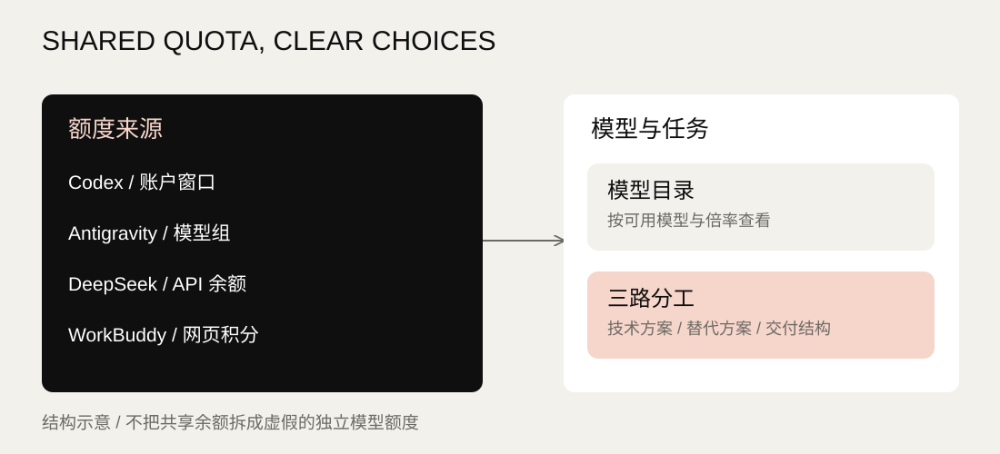

A small strip on the edge of the screen: how much quota several AI services have left, at a glance; and when Claude Code or Codex finishes a turn or waits for your approval, the strip tells you.

## From a quota table to reminders on the desktop

When one account balance appears under a dozen models, it looks as if each model had its own allowance. The project first kept pools, models and billing apart, showing only what each provider actually reports; 0.6.0 then moved the interface to an edge HUD and added done reminders and approval cards: step away for a while, glance at the strip when you are back, and you know which agent is done and which one is waiting for you.

The interface is a faithful copy of the minimal form of Agent HUD (jazzenchen/agent-hud-open, Apache-2.0); its look is not my design. My part was choosing the direction and the scope, setting the rules for reading quotas, for reminders and for approvals, and signing off the result.

### Edge strip

One quota ring per service; the number is the share used (the balance for prepaid ones), green below 70%, amber from 70%, red from 90%, and `–` when nothing could be read. Hover an icon for a line of detail; click it for that service's card: 5-hour and weekly windows, reset times, and for Claude and Codex 24 hours of token bars stacked by model.

### Done reminders

QuotaDeck only reads local session logs and changes no Claude Code or Codex setting. Seconds after a turn ends the icon becomes a smiling bot and a `New reply` capsule slides out; the reminder stays until you have seen it. `Waiting` is an inference: a tool call with no result after 30 seconds is taken as possibly waiting for you.

### Approval cards

Once connected, a command Claude Code asks to run appears as a card on the HUD, with `Allow once` and `Deny`. It is off by default; connecting backs up the existing settings first, and one click disconnects. When QuotaDeck is not running, requests fall back to the usual confirmation.

### Notch

The strip can also become a black block at the top centre of the screen (the notch): its glow takes each service's quota colour, it opens out to both sides when there is a reminder, and cards hang below it. While a full-screen 3D program such as a Steam game is in front, the whole HUD hides (a browser playing video full screen does not count); the reminders that came in meanwhile appear once it closes.



A structural sketch of shared quota sources and model choice. It holds no private balance and is not a picture of the running interface.

## Connections and current scope

| Service | Data source | Current limits |
|---|---|---|
| Codex | Local CLI: account windows and model list | A shared quota is never split into made-up per-model shares |
| Claude Code | Reads the local sign-in to call the official usage endpoint; falls back to data forwarded by the official statusLine | The token stays in the main process, never in snapshots, logs or the interface |
| Antigravity | The local service's quota and model catalogue, falling back to the CLI | Experimental interface that may change with client versions |
| DeepSeek | Official API for balance and models | Needs the user's own API key; the account balance is shared |
| WorkBuddy | An official web snapshot the user saved | Does not refresh the web page; balance and multipliers are as of the snapshot time |

Third-party names and trademarks belong to their owners.

## Build and verification

Electron and Node.js. Data reads stay in the main process; the interface only gets data through a restricted bridge. The code was written with AI coding tools: GPT wrote the back end, Claude wrote the front end and reviewed and merged.

Unit tests and desktop smoke tests cover quota mapping, session states, reminders and approvals; approval cards were signed off in a real Claude Code session: allowed commands ran, denied ones did not. Tests and builds never call a real account.

The live edition of this page runs the same HUD interface files in your browser, on simulated data.

## Run it on your own computer

Prepare Windows 11, Node.js 22+ and PowerShell 7, then install and sign in to the CLIs you need, following the repository README.

```
git clone https://github.com/CHIWAWAFROMkk/quota-deck.git
cd quota-deck
npm ci
npm run check
npm start
```

The repository's packaging script also builds a portable version (unsigned; it does not bypass Windows security prompts; a per-file SHA-256 manifest is included).

Neither the public source nor the build contains private usage snapshots, sign-in credentials or API keys. This project page only describes the tool; it does not connect to the visitor's computer or read any account.

- [Source and setup](https://github.com/CHIWAWAFROMkk/quota-deck) · [Builds and checks](https://github.com/CHIWAWAFROMkk/quota-deck/actions) · [MIT licence](https://github.com/CHIWAWAFROMkk/quota-deck/blob/main/LICENSE)
