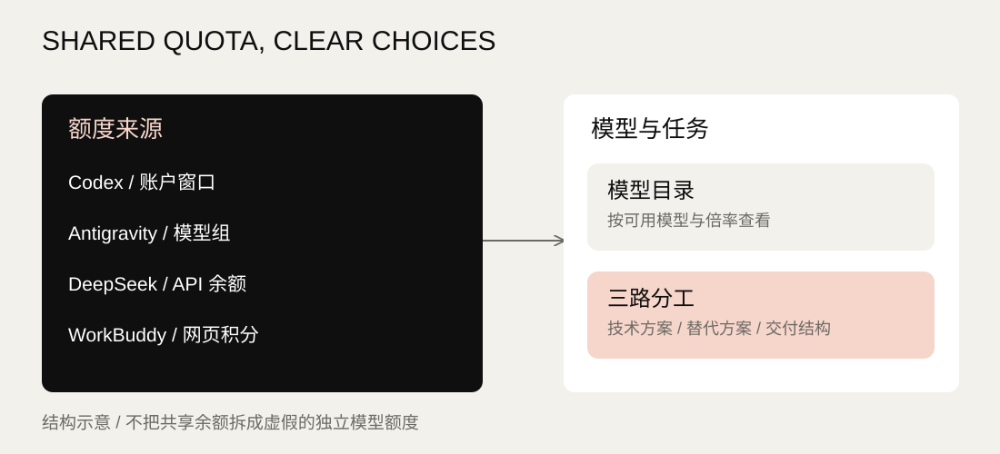

贴在屏幕边上的一条小浮条：几家 AI 服务还剩多少额度，一眼就能看到；Claude Code 或 Codex 做完一轮、等你批准时，它在浮条上提醒你。

## 从额度表到桌面上的提醒

同一个账户余额重复出现在十几个模型下，会让人误以为每个模型都有独立额度。项目先把额度池、模型与计费关系分开，只展示服务商真实提供的信息；后来把界面换成贴边 HUD，加上"做完了"提醒和批准卡片，0.7.0 又加了顶部黑块：离开电脑一阵子，回来先看浮条，就知道哪个 Agent 做完了、哪个在等你。

界面照 Agent HUD（jazzenchen/agent-hud-open，Apache-2.0）的简约形态复刻，外观不是我设计的。我做的是：选定方向和范围，定下额度读取、提醒和批准的规则，最后验收。

### 贴边浮条

每家服务一个额度环，数字是已用比例（余额类写余额），不到 70% 绿、70% 起黄、90% 起红，没读到写 `–`。鼠标停在图标上，侧边伸出一行明细；点开是这家的卡片：5 小时与每周窗口、重置时间，Claude 与 Codex 还有过去 24 小时按模型堆叠的 Token 柱。

### 做完了提醒

QuotaDeck 只读本机会话日志，不改 Claude Code 或 Codex 的配置。一轮结束后，几秒内图标变成笑脸 bot，伸出 `New reply` 提示条；提醒留到看过为止。`Waiting` 是推测：某个工具调用超过 30 秒还没结果，就当作可能在等你。

### 批准卡片

接入后，Claude Code 请求执行命令时，卡片直接出现在 HUD 上，可以 `Allow once` 或 `Deny`。默认不接入；接入前自动备份原有设置，可一键断开。QuotaDeck 没开时，请求照常回到原来的确认方式。

### 顶部黑块（Notch）

也可以把浮条换成屏幕顶部正中的一块黑色：外圈的光按各家额度着色，有提醒时向两侧展开，卡片挂在下方。按 `Ctrl+Alt+H`，或在托盘菜单里勾选对应的开关，整个 HUD 立刻藏起来，再按一次才回来；QuotaDeck 不自己判断你在做什么，期间来的提醒照常出现。



共享额度来源与模型选择的结构示意。图中不填入私人余额，不把概念图当成当前运行界面。

## 连接方式与当前范围

| 服务 | 数据来源 | 当前边界 |
|---|---|---|
| Codex | 本机 CLI：账户窗口、模型列表 | 共享额度不虚构模型独立份额 |
| Claude Code | 只读本机登录信息请求官方用量接口；读不到时用官方 statusLine 转发的数据 | 登录凭证只留在主进程，不进快照、日志或界面 |
| Antigravity | 本机服务的额度与模型目录，失败时回退 CLI | 实验性接口，随客户端版本可能变化 |
| DeepSeek | API 官方余额与模型接口 | 需要用户自己的 API 密钥；账户余额共享 |
| WorkBuddy | 用户保存的官方网页快照 | 不自动刷新网页；余额和倍率以快照时间为准 |

第三方名称与商标归各自权利人所有。

## 实现与验证

Electron 与 Node.js。读取数据放在主进程，界面只通过受限的接口拿数据。代码借助 AI 编程工具编写：GPT 写后端，Claude 写前端并审查合并；批准卡片由 DeepSeek 按 Claude 写的计划实现，Claude 审查。

单元测试与桌面冒烟测试覆盖额度映射、会话状态、提醒与批准；批准卡片在真实的 Claude Code 会话里验收过，允许后命令执行，拒绝后不执行。测试与构建不调用真实账号。

本页的完整版在浏览器里运行同一套 HUD 界面文件，数据是模拟的。

## 在自己的电脑运行

准备 Windows 11、Node.js 22+ 和 PowerShell 7，按仓库 README 安装并登录所需 CLI。

```
git clone https://github.com/CHIWAWAFROMkk/quota-deck.git
cd quota-deck
npm ci
npm run check
npm start
```

也可以用仓库里的打包脚本生成便携版（未签名，不绕过 Windows 安全提示；包内附逐文件 SHA-256 清单）。

公开源码和构建包均不包含私人用量快照、登录凭证或 API 密钥。此项目页只介绍功能，不连接访客电脑或读取账号。

- [源码与配置说明](https://github.com/CHIWAWAFROMkk/quota-deck) · [构建与检查](https://github.com/CHIWAWAFROMkk/quota-deck/actions) · [MIT 许可证](https://github.com/CHIWAWAFROMkk/quota-deck/blob/main/LICENSE)
